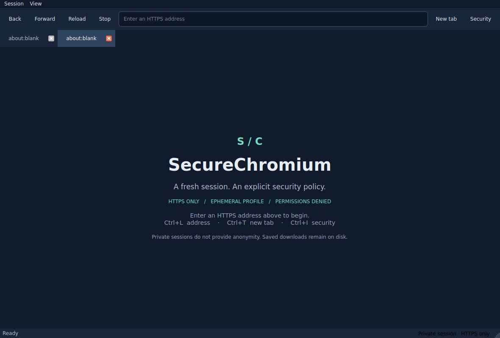

# SecureChromium

**A C++20 desktop browser built on Qt WebEngine, with explicit security policy and an ephemeral session.**

  

SecureChromium demonstrates browser integration, modern C++ ownership, network policy enforcement, and security-focused product decisions. Qt WebEngine supplies Chromium; this repository implements the desktop shell and its policies. It does not contain a Chromium fork or claim a security audit.



## Features

- Tabbed browsing with back, forward, reload, stop, and keyboard navigation.
- HTTPS-only destinations and network requests; HTTP is rejected rather than silently upgraded. Invalid certificates have no bypass dialog.
- Private, unnamed profile with memory cache, no persistent cookies, and third-party cookie filtering.
- Device permissions denied; clipboard access, popups, local-file access from pages, plugins, fullscreen, and screen capture restricted.
- Explicit download confirmation, private staging, filename sanitization, no automatic execution, and visible progress/errors.
- Reset session closes tabs, cancels downloads, and disposes the profile. Saved files remain on disk.
- Startup rejects common unsafe WebEngine environment overrides and privileged execution.

Read the [threat model](docs/THREAT_MODEL.md) before relying on these controls. JavaScript remains enabled. There is no anonymity service, tracker blocklist, malware scanner, password manager, extension system, or browser updater.

## Build and run

Linux is the validated development target. CMake 3.22+, a C++20 compiler, and Qt 6.4+ development packages are required. **6.4 is an API compatibility floor, not a recommended engine version.** Deploy only with a Qt WebEngine release receiving security fixes from your provider; rebuild and redistribute when its Chromium patches change.

On Ubuntu 24.04, install the compatibility build dependencies:

```sh
sudo apt-get update
sudo apt-get install cmake ninja-build g++ qt6-base-dev qt6-webengine-dev
cmake --preset dev
cmake --build --preset dev
./build/securechromium https://www.qt.io
```

For a Qt SDK outside the system paths, add `-DCMAKE_PREFIX_PATH=/path/to/Qt/<version>/<toolchain>` to configuration. Do not mix headers and runtime libraries from different Qt SDKs.

```sh
cmake --preset release
cmake --build --preset release
cmake --install build-release --prefix "$HOME/.local"
```

Run as a normal user. Do not disable Chromium's sandbox to work around a launch failure. Linux containers must permit the engine's supported sandbox mechanism; see [testing](docs/TESTING.md). Qt runtime resources, helper processes, plugins, and licenses must accompany a packaged distribution. The CMake install rule installs the executable only; see [release checklist](docs/RELEASING.md).

## Use

Enter a hostname (automatically prefixed with `https://`) or a full HTTPS URL. Search queries and arbitrary URL schemes are rejected. `about:blank` opens an empty tab. Unsolicited page windows are blocked; open tabs using the toolbar.

| Shortcut | Action |
|---|---|
| Ctrl+L | Focus address |
| Ctrl+T | New tab |
| Ctrl+W | Close tab |
| Alt+Left / Alt+Right | Back / forward |
| F5 / Escape | Reload / stop |
| Ctrl+I | Security summary |

The **Session** menu resets browsing state; **View → Downloads** shows transfers. Cancellation of a save dialog cancels the transfer. Existing destination files are never intentionally replaced. A crash can leave a hidden staging directory; inspect and remove `.securechromium-*` directories in the selected download folder when the app is closed.

## Test

```sh
ctest --preset dev
```

Tests cover hostile URL input, protocol/credential policy, safe filenames, startup guards, profile defaults, real request interception, self-signed TLS certificate rejection, and window/page lifetime. Tests require Qt Test and a working sandbox-capable desktop or headless Linux environment. See [test details and manual security cases](docs/TESTING.md).

## Engineering guide

- [Architecture and ownership](docs/ARCHITECTURE.md)
- [Threat model and limitations](docs/THREAT_MODEL.md)
- [Testing](docs/TESTING.md) · [Recorded validation](docs/VALIDATION.md)
- [Release checklist](docs/RELEASING.md)
- [Contributing](CONTRIBUTING.md) · [Security reporting](SECURITY.md) · [License](LICENSE)

Qt references: [WebEngine overview](https://doc.qt.io/qt-6/qtwebengine-overview.html), [profile](https://doc.qt.io/qt-6/qwebengineprofile.html), [request interception](https://doc.qt.io/qt-6/qwebengineurlrequestinterceptor.html), [certificate errors](https://doc.qt.io/qt-6/qwebenginecertificateerror.html).

## Portfolio walkthrough

Start with `src/policy.cpp` for the security decisions, then `src/browser.cpp` for Chromium integration. Discuss the split between page navigation and resource interception, Qt object ownership, profile destruction during reset, download staging, and the distinction between browser policy and engine-level isolation. The documentation records deliberate compatibility tradeoffs and residual risks rather than claiming that a small shell makes Chromium vulnerability-free.

The repository includes CI, issue templates, a pull request template, and release guidance. It is ready to push to a GitHub repository; no remote hosting or published release is implied.
