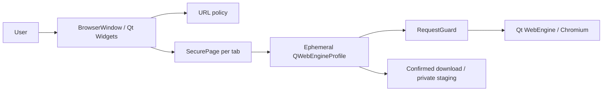

# Architecture

`policy` is the shared source of URL decisions and input normalization. Address entry accepts HTTPS destinations or `about:blank`; embedded credentials and local/external schemes fail closed. Page navigation also checks URLs reached through links and redirects. Resource interception rejects insecure and local schemes regardless of the address bar. Data and blob resources are allowed for page operation, but not as top-level destinations. Secure WebSocket support is intentionally not promised; see the threat model.

`SecurePage` rejects certificate errors, permissions, fullscreen, and popup creation. `createProfile` defines the privacy and WebEngine settings before pages exist. All tabs in one window share one ephemeral profile, so cookies and site storage are shared for that session. There is no per-tab identity isolation.

`BrowserWindow` owns its profile and tabs. Views own pages. The destructor explicitly deletes all views before the profile's QObject destruction. Reset creates a new window, then closes and deletes the old one, disposing the full profile rather than merely clearing cookies. Active downloads belong to that profile and are cancelled on destruction. A transient reset can briefly have both windows alive in Qt's deferred deletion cycle.

The interceptor can execute on an engine thread. It performs no UI calls and emits only a counter signal connected to the window using a queued connection. It never logs URLs or waits on GUI callbacks. Other UI and download updates run on the GUI thread.

Downloads use Qt's request object. Before acceptance, the user confirms and chooses a path. The engine writes to a unique private directory beside that destination. A completed file is renamed to the chosen path; Qt refuses an existing destination. If finalization fails, the UI reports failure and the staged file is discarded when the request is destroyed. Files are never executed. This does not protect against a hostile account with access to the destination directory or against a compromised renderer/engine.

CMake builds the core as a library for test reuse, the application, and separate Qt Test executables. Application code uses QObject ownership and local values; download staging is shared only between callbacks that need its lifetime. No global browser state or telemetry service is introduced.
